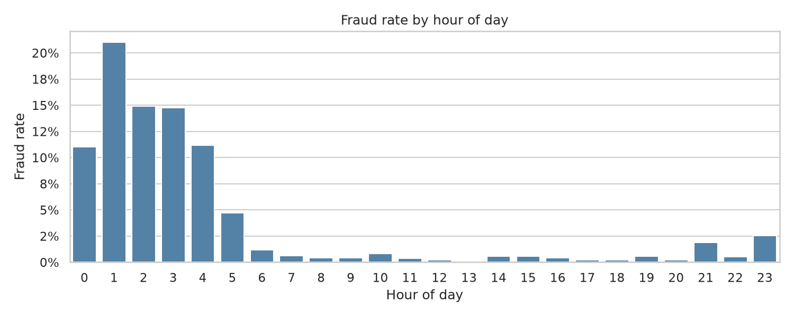
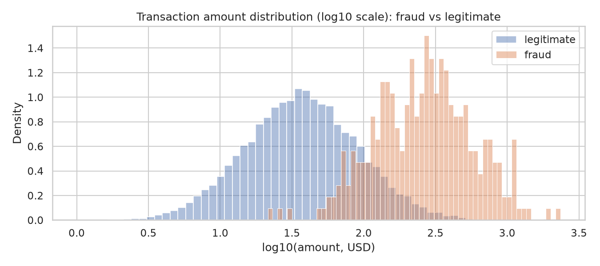
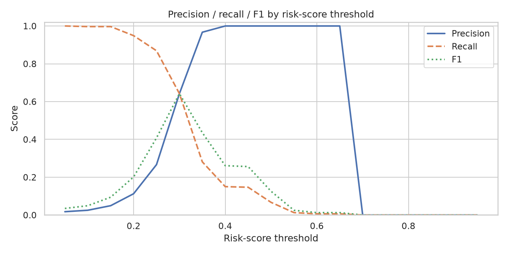
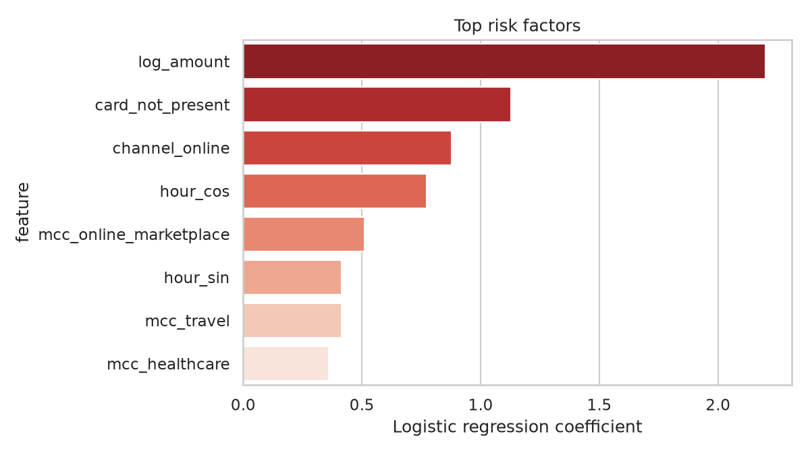

# Financial Fraud Detection — Card Transactions

> **Portfolio project. All data is synthetic** — generated by `src/generate_data.py`
> (seed 42). No real bank, card network, or customer data is used anywhere in
> this repository, and no real institution is named.

Detect fraudulent card transactions with a transparent, production-style
pipeline: analyst-written **business rules** plus **unsupervised anomaly
detection** (IsolationForest), blended into a single **risk score** that
prioritizes an investigator review queue.

## Business Problem

Fraud teams face a classic trade-off: catch more fraud without flooding
investigators with false positives. Pure rule systems are explainable but miss
novel fraud; pure ML scores are opaque and hard for analysts to trust. This
project builds both layers and combines them into one explainable risk score,
then picks a review threshold from an explicit precision/recall trade-off —
mirroring how a fraud-operations team would actually ship this.

## Dataset

`data/transactions.csv` — **20,000 synthetic** card transactions, **313 labeled
fraud (1.57%)**. Labels are simulated ground truth used *only for evaluation*;
detection itself runs label-free.

| Column | Description |
|---|---|
| `txn_id` | Unique transaction id |
| `amount` | Transaction amount (USD) |
| `merchant_category` | grocery, gas, restaurant, retail, travel, online_marketplace, electronics, healthcare |
| `hour_of_day` | 0–23 |
| `channel` | `online` / `in-store` |
| `card_present` | 1 = card physically present |
| `customer_tenure_months` | Account age |
| `days_since_last_txn` | Customer velocity |
| `is_fraud` | 1 = fraud (synthetic label) |

Fraud was engineered to correlate with high amounts, night hours (0–5),
online channel, card-not-present, new accounts, and rapid-fire sequences.
See `data/README.md`. Regenerate deterministically with
`python src/generate_data.py`.

## Objectives

1. Validate and clean the transaction feed the way a production ingest would.
2. Quantify where fraud concentrates (EDA + SQL).
3. Encode domain knowledge as transparent business rules.
4. Detect novel fraud with unsupervised anomaly detection.
5. Blend rules + anomaly into a risk score and select a review threshold from
   measured precision/recall trade-offs.

## Data Cleaning

`src/data_cleaning.py` validates schema/dtypes, nulls, duplicate `txn_id`s,
and value ranges (amount > 0, hour 0–23, channel in {online, in-store},
binary flags, non-negative tenure/gap). Result on this dataset: **20,000 rows
in, 20,000 rows out, zero issues** — and it adds `hour_bucket` and `log_amount`
features used downstream.

## SQL Analysis

`sql/analysis_queries.sql` (SQLite-compatible) answers the core fraud questions
directly against the CSV:

1. Fraud rate by merchant category
2. Fraud rate by hour bucket
3. Fraud rate by channel
4. Average/min/max amount: fraud vs legitimate
5. Rule-flagged transaction counts (mirrors the Python rules)

Example — riskiest slice in one query: *online + night (0–5) +
card-not-present* has a **53.6% fraud rate (163 of 304 transactions)**.

## EDA

Key findings from `src/analysis.py` and `notebooks/analysis.ipynb`:

- **Hour:** night (0–5) fraud rate **12.2%** vs 0.4–0.6% during the day.
- **Channel:** online **3.57%** vs in-store 0.44%.
- **Card presence:** card-not-present **5.25%** vs card-present 0.24%.
- **Merchant category:** online_marketplace (5.23%) and electronics (4.40%)
  lead; grocery is lowest (0.15%).
- **Amount:** median fraud **$266.10** vs legitimate **$36.87**; 99th
  percentile fraud $1,319 vs legitimate $308.

## Key Insights

1. Fraud concentrates exactly where domain knowledge predicts: **night hours,
   online, card-not-present, high amounts, new accounts** — the single
   riskiest slice (online × night × card-not-present) is over half fraud.
2. Transparent rules alone are **high-precision but low-recall** (precision
   100%, recall 15.0%, queue of 47) — they miss fraud that doesn't match known
   signatures.
3. Adding unsupervised anomaly detection recovers the missed fraud: at the
   recommended threshold the blended score reaches **64.2% precision and
   64.2% recall** with a reviewable queue of 313 transactions (1.6% of volume).
4. Top risk factors (logistic-regression ranking, interpretation only):
   `log_amount` (+2.20), `card_not_present` (+1.13), `channel_online` (+0.88),
   `hour_cos` (+0.77), `mcc_online_marketplace` (+0.51).

## ML Methodology

**Detection is label-free.** Labels are used only to measure performance.

- **Business rules** (`src/model.py::apply_rules`) — 4 transparent flags:
  - R1: amount ≥ $2,000 AND card-not-present
  - R2: hour 0–5 AND amount ≥ $500
  - R3: account age ≤ 3 months AND online AND amount ≥ $800
  - R4: < 0.1 days since last transaction AND amount ≥ $1,500
- **IsolationForest** (`contamination=0.02`, 200 trees, seed 42) on engineered
  features: log amount, cyclic hour (sin/cos), night flag, channel, card
  presence, log tenure, log velocity, one-hot merchant category. Anomaly scores
  min-max scaled to [0, 1].
- **Risk score:** `0.6 × (rules hit / 4) + 0.4 × isolation anomaly` — every
  queued transaction shows *which rules fired* plus its anomaly level, so
  investigators see the "why".

### Threshold analysis (measured on the 20,000 transactions)

| Threshold | Queue size | % of volume | Precision | Recall | F1 |
|---|---|---|---|---|---|
| 0.30 | 313 | 1.57% | **64.2%** | **64.2%** | **64.2%** |
| 0.50 | 21 | 0.10% | 100.0% | 6.7% | 12.6% |
| 0.70 | 0 | 0.00% | — | 0.0% | 0.0% |

**Recommended operating threshold: 0.30** — best F1; a 313-transaction queue
(1.6% of volume) is staffable, and nearly two-thirds of queue items are true
fraud. Threshold 0.50 is the "surgical" option (every flagged item is fraud,
but most fraud is missed). Threshold 0.70 flags nothing — scores rarely reach
that high with this blend, which is itself a useful calibration finding.

## Dashboard

Fraud-operations KPIs and layout spec: `dashboard/README.md`.






## Results & Metrics

- **Dataset:** 20,000 synthetic transactions, 313 fraud (1.57%)
- **Rules alone:** precision 100.0%, recall 15.0%, queue 47
- **Rules + IsolationForest @ 0.30:** precision **64.2%**, recall **64.2%**,
  F1 **64.2%**, queue **313 (1.6% of volume)**
- **Top risk factors:** log_amount, card_not_present, channel_online,
  night-hour encoding, online_marketplace merchant category
- All figures above are from the executed run (`python src/model.py` and the
  executed notebook); re-run to reproduce exactly (seed 42).

## Technologies Used

Python · Pandas · NumPy · scikit-learn (IsolationForest, LogisticRegression) ·
Matplotlib · Seaborn · SQLite-compatible SQL · Jupyter

## How to Run

```bash
git clone https://github.com/sreyapeddu-analytics/financial-fraud-detection.git
cd financial-fraud-detection
python -m venv .venv && source .venv/bin/activate
pip install -r requirements.txt

# regenerate the synthetic data (deterministic, seed 42)
python src/generate_data.py

# run validation + EDA + full model pipeline (prints all metrics)
python src/data_cleaning.py
python src/analysis.py
python src/model.py

# open the executed narrative notebook
jupyter notebook notebooks/analysis.ipynb
```

## Resume-Ready Description

> Built an end-to-end fraud detection pipeline on 20,000 synthetic card
> transactions: engineered business rules and an IsolationForest anomaly model,
> blended into an explainable risk score. At the selected threshold the system
> achieves 64% precision and 64% recall with a reviewable queue of 1.6% of
> transaction volume, surfacing night-hour, card-not-present, and high-amount
> patterns as top risk factors. (Python, scikit-learn, SQL, Pandas.)
